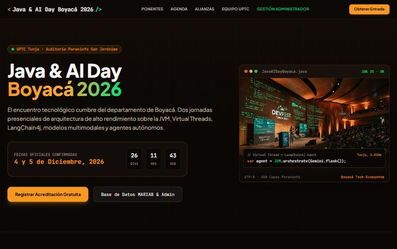

# ☕🤖 Java & AI Day Boyacá 2026 — Landing Page

> Landing page oficial del evento **Java & AI Day Boyacá 2026**: dos jornadas presenciales en el Auditorio Paraninfo San Jerónimo de la **UPTC (Tunja)** sobre la JVM, Virtual Threads, LangChain4j, modelos multimodales y agentes autónomos. Permite conocer a los ponentes, consultar la agenda y registrar una acreditación gratuita.

[](https://jonathanstickgb.github.io/landing-page-proyecto_Unidad_3/)
[](https://developer.mozilla.org/es/docs/Web/HTML)
[](https://developer.mozilla.org/es/docs/Web/CSS)
[](https://developer.mozilla.org/es/docs/Web/JavaScript)
[](https://aistudio.google.com/)
[](LICENSE)

🔗 **Sitio en vivo:** [https://jonathanstickgb.github.io/landing-page-proyecto_Unidad_3/](https://jonathanstickgb.github.io/landing-page-proyecto_Unidad_3/)

---

## 📸 Vista previa



---

## 📑 Tabla de contenido

- [Características](#-características)
- [Tecnologías utilizadas](#️-tecnologías-utilizadas)
- [Proceso de desarrollo (metodología de 5 fases)](#-proceso-de-desarrollo-metodología-de-5-fases)
- [Estructura del proyecto](#-estructura-del-proyecto)
- [Ejecución local](#-ejecución-local)
- [Instrucciones de personalización](#-instrucciones-de-personalización)
- [Gestión del proyecto](#-gestión-del-proyecto)
- [Créditos](#-créditos)
- [Licencia](#-licencia)

---

## ✨ Características

- **Hero con cuenta regresiva** en tiempo real hasta el inicio del evento (4 y 5 de diciembre de 2026).
- **Sección de ponentes** con animación *reveal-on-scroll* implementada con la API `IntersectionObserver`, con retrasos escalonados (`delay-1`, `delay-2`, `delay-3`).
- **Agenda** del evento organizada por jornadas.
- **Sección "Organizan y Apoyan"** con tarjetas de borde punteado: UPTC, Java Community Colombia (JUG), Boyacá Devs y RedIA.
- **Equipo UPTC** responsable del proyecto.
- **Registro de acreditación gratuita** mediante formulario modal con validación de campos.
- **Panel de gestión de acreditaciones** (búsqueda, check-in, edición y eliminación de registros) con persistencia local en `localStorage`.
- **Tema visual Java & IA:** fondo espresso (`#0a0705`), acentos naranja Java (`#f89820`) y verde IA (`#00e676`), y una malla decorativa inspirada en un IDE (`.bg-ide-grid`).
- **Diseño responsive** para móvil, tablet y escritorio.

---

## 🛠️ Tecnologías utilizadas

| Tecnología | Uso en el proyecto |
|---|---|
| **HTML5** | Estructura semántica (`header`, `main`, `section`, `footer`), metadatos SEO y Open Graph, formularios accesibles. |
| **CSS3** | Variables CSS (*design tokens*) en `:root`, Flexbox, CSS Grid, animaciones y transiciones. |
| **Tailwind CSS (CDN)** | Clases utilitarias para maquetación rápida y responsive. |
| **JavaScript ES6+** | `IntersectionObserver`, cuenta regresiva, manipulación del DOM, módulo de registros con `localStorage`, funciones flecha y *template literals*. |
| **Google AI Studio** | Asistente de IA para generar el prototipo inicial del diseño, proponer la estructura de secciones y apoyar la redacción del contenido; el código resultante fue revisado y adaptado por el equipo. |
| **Git & GitHub** | Control de versiones, ramas `feature/*` y `fix/*`, Pull Requests, Issues y GitHub Projects (Kanban). |
| **GitHub Pages** | Despliegue público y continuo desde la rama `main`. |

---

## 🔄 Proceso de desarrollo (metodología de 5 fases)

### Fase 1 — Análisis y planificación
- Definición del objetivo de la landing (promocionar el evento y captar registros) y de su público (estudiantes, docentes y profesionales de Boyacá).
- Creación del repositorio, del tablero Kanban en **GitHub Projects** y de los **Issues** iniciales con prefijos `[TAREA]`, `[BUG]` y `[MEJORA]`.

### Fase 2 — Diseño y prototipado con IA
- Generación de un primer prototipo en **Google AI Studio** a partir de un *prompt* con el concepto del evento.
- Definición de la identidad visual: paleta Java & IA, tipografías *Plus Jakarta Sans* y *JetBrains Mono*, y estética de editor de código.

### Fase 3 — Desarrollo (maquetación e interactividad)
- Maquetación semántica en HTML5 y estilos con variables CSS y Tailwind.
- Implementación en JavaScript del menú, la cuenta regresiva, las animaciones con `IntersectionObserver` y el módulo de registro de acreditaciones.
- Trabajo en ramas de características y fusión mediante **Pull Requests**.

### Fase 4 — Pruebas y auditoría
- Pruebas en distintos tamaños de pantalla (375 px, 768 px y 1280 px) y en varios navegadores.
- Auditoría de accesibilidad, contraste y rendimiento, y corrección de los errores registrados como Issues `[BUG]`.

### Fase 5 — Despliegue y documentación
- Publicación en **GitHub Pages** desde la rama `main`.
- Redacción de este README, actualización del tablero Kanban y cierre de Issues con referencia al commit que los resolvió.

---

## 📁 Estructura del proyecto

```
landing-page-proyecto_Unidad_3/
├── index.html          # Estructura de la landing (secciones y modales)
├── styles.css          # Variables de diseño, animaciones y estilos propios
├── script.js           # Interactividad: animaciones, cuenta regresiva y registros
├── images/             # Imágenes del hero y de los ponentes
├── docs/               # Recursos de documentación (captura del README)
├── schema_MARIAB*.sql  # Esquema de base de datos de referencia (no se ejecuta en GitHub Pages)
├── LICENSE
└── README.md
```

---

## 💻 Ejecución local

1. Clona el repositorio:
   ```bash
   git clone https://github.com/jonathanStickgb/landing-page-proyecto_Unidad_3.git
   ```
2. Entra a la carpeta del proyecto:
   ```bash
   cd landing-page-proyecto_Unidad_3
   ```
3. Abre `index.html` en el navegador, o usa la extensión **Live Server** de Visual Studio Code.

> No requiere instalación ni dependencias: Tailwind y las fuentes se cargan desde CDN.

---

## 🎨 Instrucciones de personalización

Puedes reutilizar esta landing para otro evento cambiando estos puntos:

1. **Colores:** edita las variables de `:root` en `styles.css` y el bloque `tailwind.config` dentro de `<head>` en `index.html`.
   ```css
   :root {
     --bg-espresso: #0a0705;        /* fondo principal */
     --color-java-orange: #f89820;  /* color de acento */
     --color-ai-green: #00e676;     /* color secundario */
   }
   ```
2. **Textos:** cambia el título, la descripción, la agenda y los ponentes directamente en `index.html`. Cada sección está marcada con un comentario (`<!-- ===== ... ===== -->`) y un `id` (`ponentes`, `agenda`, `alianzas`, `equipo`).
3. **Fecha del evento:** modifica la fecha objetivo de la cuenta regresiva en `script.js`:
   ```js
   const targetTime = new Date('2026-12-04T08:00:00-05:00').getTime();
   ```
4. **Imágenes:** reemplaza los archivos de `images/` conservando el mismo nombre, o actualiza la ruta en el atributo `src`. Usa rutas relativas (`images/foto.jpg`) y respeta mayúsculas y minúsculas para que funcionen en GitHub Pages.
5. **Tipografías:** cambia la URL de Google Fonts en el `<head>` de `index.html` y los nombres de fuente en `tailwind.config`.
6. **Metadatos y SEO:** actualiza `<title>`, `meta description` y las etiquetas Open Graph (`og:*`) para que el enlace se vea bien al compartirlo.
7. **Publicar tu versión:** haz un *fork*, ve a **Settings → Pages → Deploy from a branch → `main` / `root`** y espera un par de minutos.

---

## 📋 Gestión del proyecto

- **Tablero Kanban:** [GitHub Project](https://github.com/users/jonathanStickgb/projects/3)
- **Issues:** [Issues del repositorio](https://github.com/jonathanStickgb/landing-page-proyecto_Unidad_3/issues)
- **Historial de cambios:** [Commits](https://github.com/jonathanStickgb/landing-page-proyecto_Unidad_3/commits/main)
- **Convención de commits:** [Conventional Commits](https://www.conventionalcommits.org/es/v1.0.0/) (`feat:`, `fix:`, `style:`, `refactor:`, `docs:`, `chore:`).

---

## 👥 Créditos

**Equipo de desarrollo — Escuela de Ingeniería de Sistemas y Computación, UPTC**

| Integrante | Rol |
|---|---|
| **María Medina** ([@mariamedina-cmd](https://github.com/mariamedina-cmd)) | Arquitectura HTML semántica, accesibilidad (WCAG) y SEO / Open Graph. |
| **Natalia Cruz** ([@nataliacruzmoreno](https://github.com/nataliacruzmoreno)) | Interactividad en JavaScript, `IntersectionObserver`, animaciones *reveal-on-scroll* y estilos CSS. |
| **Jonathan Stick Fuentes** ([@jonathanStickgb](https://github.com/jonathanStickgb)) | Documentación, configuración del repositorio, flujo de ramas y despliegue en GitHub Pages. |

**Recursos de terceros**

- [Google AI Studio](https://aistudio.google.com/): prototipado y apoyo en la generación de contenido.
- [Tailwind CSS](https://tailwindcss.com/): framework de utilidades CSS.
- [Google Fonts](https://fonts.google.com/): *Plus Jakarta Sans* y *JetBrains Mono*.
- [Shields.io](https://shields.io/): insignias del README.
- Imágenes de la carpeta `images/`: uso ilustrativo con fines académicos.

Proyecto académico de la Unidad 3, Universidad Pedagógica y Tecnológica de Colombia (UPTC), Tunja, 2026.

---

## 📄 Licencia

Distribuido bajo la licencia **MIT**. Consulta el archivo [LICENSE](LICENSE).
